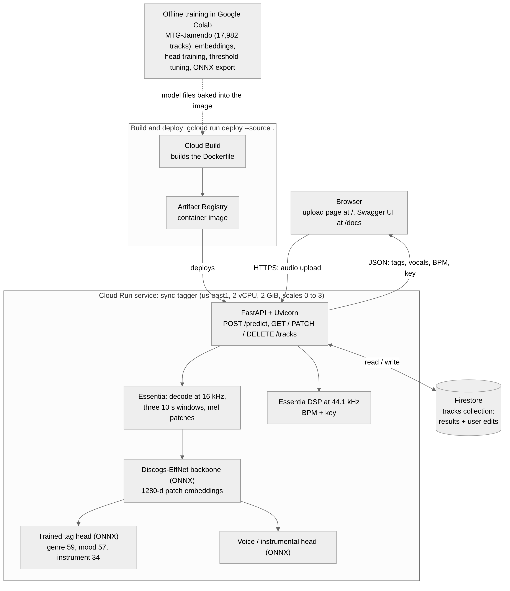

# Sync Tagger

A cloud-native AI inference microservice that listens to a music track and returns
the metadata a sync-licensing submission asks for: **genre, mood/theme,
instrumentation, vocals vs. instrumental, BPM and key**.

Upload a track on the web page (or call the API), get tags back in a few seconds,
edit them, and copy a ready-made keyword list and description. Every analysis is
saved to a "crate" in Firestore so it can be pulled up again later.

**Live service:** https://sync-tagger-1002974632366.us-east1.run.app
(API docs at [`/docs`](https://sync-tagger-1002974632366.us-east1.run.app/docs))

Built as the final project for *Cloud & Internet Computing for AI Engineering*.
It builds on a GTZAN genre classifier I made for a Machine Learning Frameworks
course; this version replaces it with a new multi-label model, a new dataset and a
full cloud deployment.



## How it works

1. **FastAPI** receives the upload (`POST /predict`) and writes it to a temp file.
2. **Essentia** decodes it to 16 kHz mono and takes three 10-second windows (at 25%,
   50% and 75% of the track), turning each into 128-frame mel-spectrogram patches.
3. **Discogs-EffNet** (pretrained, run with ONNX Runtime) turns each patch into a
   1280-dimensional embedding. Mean + standard deviation over patches gives one
   2560-d vector per track.
4. **My trained tag head** (ONNX, normalization and sigmoid built in) outputs
   probabilities for 59 genres, 57 moods/themes and 34 instruments. Per-tag
   thresholds tuned on validation data decide which tags are returned; tags just
   under their threshold come back as suggestions.
5. **Essentia's pretrained voice/instrumental head** (converted to ONNX) runs on the
   same patch embeddings.
6. **Essentia's signal-processing extractors** estimate BPM (plus half/double-time
   and 3:2 alternates) and key (plus relative key and Camelot code) at 44.1 kHz.
7. The result is saved to **Firestore** (`tracks` collection) and returned as JSON.

## The model

| | |
|---|---|
| Backbone | Discogs-EffNet (Essentia, frozen), dynamic-batch ONNX export |
| Training data | MTG-Jamendo mood/theme subset: 17,982 full-length tracks, official artist-separated split (train 9,949 / validation 3,802 / test 4,231) |
| Head | Shared trunk: dropout 0.2, Linear 2560→256, ReLU, dropout 0.5; one linear output layer per category |
| Loss | Masked binary cross-entropy with capped `pos_weight` (tracks with no tags in a category don't count as negatives for it) |
| Tag vocabulary | Tags with ≥50 train, ≥10 validation and ≥10 test examples |

**Test-set results** (evaluated once, after all choices were made on validation):

| Head | ROC-AUC | PR-AUC | macro-F1 |
|---|---|---|---|
| Genre | 0.862 | 0.254 | 0.278 |
| Mood/theme | 0.758 | 0.139 | 0.171 |
| Instrument | 0.799 | 0.252 | 0.246 |

For reference, the MediaEval 2019 mood/theme baseline (VGG-ish) scored 0.108 PR-AUC
and the best submission 0.155 on the same test set.

## API

| Method | Path | What it does |
|---|---|---|
| GET | `/` | Upload page |
| GET | `/health` | Service status, whether models loaded, which crate store is in use |
| POST | `/predict?top_k=5` | Analyze an audio file (multipart `file`, max 30 MB): tags, suggestions, vocals, BPM, key; saves to the crate |
| GET | `/tracks` | Past analyses, newest first |
| GET | `/tracks/{id}` | One analysis with the user's edits |
| PATCH | `/tracks/{id}` | Save edits: removed tags, added tags, chosen BPM, vocals correction |
| DELETE | `/tracks/{id}` | Remove from the crate |

```bash
curl -X POST "https://sync-tagger-1002974632366.us-east1.run.app/predict?top_k=5" \
  -F "file=@my_beat.mp3"
```

## Project structure

```
main.py            FastAPI app and endpoints
tagger.py          Audio -> embeddings -> tags, vocals, BPM, key
storage.py         The crate: Firestore on Cloud Run, a local JSON file otherwise
static/index.html  The upload page
models/            ONNX models + tag names and thresholds
Dockerfile, requirements.txt, .dockerignore, .gcloudignore
keytest.py         Evaluation script: compares Essentia key profiles against known keys
```

## Run it locally

Requires Docker.

```bash
docker build -t sync-tagger .
docker run --rm -p 8080:8080 -e CRATE_PATH=/data/crate.json -v "$PWD/data:/data" sync-tagger
```

Open http://localhost:8080. Locally the crate is a JSON file in `./data`; on Cloud Run
it's Firestore (chosen automatically, or set `CRATE_STORE=local|firestore`).

## Deploy to Google Cloud Run

```bash
gcloud services enable run.googleapis.com cloudbuild.googleapis.com \
  artifactregistry.googleapis.com firestore.googleapis.com
gcloud firestore databases create --location=us-east1

# the default compute service account builds the image and reads/writes Firestore
NUM=$(gcloud projects describe PROJECT_ID --format="value(projectNumber)")
gcloud projects add-iam-policy-binding PROJECT_ID \
  --member="serviceAccount:$NUM-compute@developer.gserviceaccount.com" --role="roles/run.builder"
gcloud projects add-iam-policy-binding PROJECT_ID \
  --member="serviceAccount:$NUM-compute@developer.gserviceaccount.com" --role="roles/datastore.user"

gcloud run deploy sync-tagger --source . --region us-east1 --allow-unauthenticated \
  --memory 2Gi --cpu 2 --concurrency 4 --max-instances 3 --timeout 300
```

## Known limitations

- **Genre reflects the training tags.** Jamendo's "hiphop" tag mostly marks rap
  songs, so instrumental hip-hop tends to come back as chill-out/downtempo; hip-hop
  is offered as a close-call suggestion instead.
- **Vocals in dense mixes:** the instrument head misses vocals that sit inside busy
  arrangements (and rap in particular), which is why a dedicated voice/instrumental
  model was added.
- **Key detection** is usually close but often lands one step away on the Camelot
  wheel; across 9 tracks with independently sourced keys, none of Essentia's 12 key
  profiles reliably beat the default, so the relative key and Camelot code are shown.
- **Tempo** can come back at half, double or 3:2 of the published value; alternates
  are offered instead of silently "corrected".
- **Uploads over 32 MB** exceed Cloud Run's request limit (long WAVs); export an MP3.
- **No authentication:** anyone with the URL can see and edit the crate.

## Credits and licensing

- Discogs-EffNet and the voice/instrumental classifier: [Essentia models](https://essentia.upf.edu/models.html)
  (Music Technology Group, Universitat Pompeu Fabra), released for non-commercial use.
- Training data: [MTG-Jamendo dataset](https://github.com/MTG/mtg-jamendo-dataset),
  Creative Commons licensed audio.
- Because of these licenses, this project is for educational and personal use.
